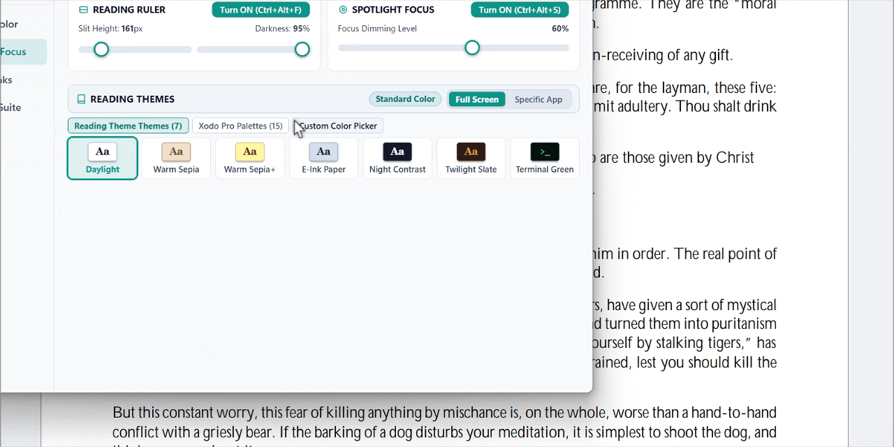

<p align="center">
  
</p>

<h1 align="center">EyeGuard</h1>

<h3 align="center">The First Full-Desktop E-Reader & Eye Care Suite for Windows</h3>

<p align="center">
  <b>Transform your entire Windows desktop into a comfortable, paper-like reading environment.</b><br>
  Say goodbye to blinding white PDFs, dry eyes, ocular headaches, and fragmented screen-tinting tools.
</p>

<p align="center">
  <a href="https://hocinechero.github.io/EyeGuard/"></a>
  <a href="https://github.com/hocinechero/EyeGuard/releases"></a>
  <a href="https://github.com/microsoft/winget-pkgs/pull/478905"></a>
  <a href="https://www.virustotal.com/gui/file/88eb7509826c64ce164159e0e1cb84202cec6ad9ae6dae394f7e4366f9a57c93"></a>
  <a href="https://alternativeto.net/software/eyeguard/"></a>
  <a href="https://github.com/hocinechero/EyeGuard"></a>
  <a href="LICENSE"></a>
  <a href="https://github.com/hocinechero/EyeGuard"></a>
  <a href="https://github.com/hocinechero/EyeGuard"></a>
  <a href="https://github.com/hocinechero/EyeGuard/stargazers"></a>
</p>

---

<div align="center">

### 🚀 Instant Downloads & Installation (Version 3.0.0)

🌐 **Official Website:** **[hocinechero.github.io/EyeGuard](https://hocinechero.github.io/EyeGuard/)**

```powershell
# 1-Command Install via Windows Package Manager
winget install hocinechero.EyeGuard
```

| Package | Description | Direct Download | Security Scan |
| :--- | :--- | :---: | :---: |
| ⚡ **EyeGuard Portable** | **No installation required.** Extract and run `EyeGuard.exe` directly from desktop or USB drive. | [📥 **Download EyeGuard_Portable.zip**](https://github.com/hocinechero/EyeGuard/releases/download/v3.0.0/EyeGuard_Portable.zip) | [🛡️ **0/66 Clean**](https://www.virustotal.com/gui/file/88eb7509826c64ce164159e0e1cb84202cec6ad9ae6dae394f7e4366f9a57c93) |
| 📦 **EyeGuard Installer** | Complete Windows setup wizard with Start Menu shortcuts and optional auto-start. | [📥 **Download EyeGuard_Setup.exe**](https://github.com/hocinechero/EyeGuard/releases/download/v3.0.0/EyeGuard_Setup.exe) | [🛡️ **70/71 Clean**](https://www.virustotal.com/gui/file/a92a05f6c87fc4015f665b97c54f65abeb1652d21efd61b7d729966342c3e784) |
| 🪟 **Winget Package** | Official Windows Package Manager distribution. Automatically tracked and updated. | `winget install hocinechero.EyeGuard` | Microsoft Pipeline |

</div>

---

## 🎬 Live Demonstration

<div align="center">
  
  <p><em>Watch the line-by-line Digital Reading Ruler guide your gaze effortlessly across dense text, PDFs, and code editors with zero ocular fatigue.</em></p>
</div>

---

## 💡 A Brand New Software Category

Most screen tools do only one thing: they turn your monitor orange. Dedicated document viewers (like Kindle, ReadEra, or Xodo) offer wonderful reading themes, but **they only work inside their own window**.

**EyeGuard is the first utility to bring the full e-reader experience to your entire Windows desktop.** 

Whether you are reading research papers in Adobe Acrobat, browsing long documentation in Chrome, writing essays in Word, or reviewing code in VS Code, EyeGuard turns your display into a gentle, paper-like surface.

### 📊 How EyeGuard Compares

| Feature | Windows Night Light | f.lux | CareUEyes (Paid) | 🛡️ **EyeGuard (v3.0.0)** |
| :--- | :---: | :---: | :---: | :---: |
| **Line-by-Line Reading Ruler** | ❌ No | ❌ No | 💲 $20/yr | ✅ **Yes (Smooth Cursor Tracking)** |
| **Paragraph Spotlight Focus Mask** | ❌ No | ❌ No | ❌ No | ✅ **Yes (Custom Width & Dimming)** |
| **Kindle / E-Ink / Sepia Themes** | ❌ No | ❌ No | ❌ No | ✅ **Yes (22 Authentic Palettes)** |
| **Ultra-Deep Dimming (Below 0%)** | ❌ No | ❌ No | 💲 $20/yr | ✅ **Yes (Down to 5% Brightness)** |
| **Clinical 20-20-20 Break Scheduler** | ❌ No | ❌ No | 💲 $20/yr | ✅ **Yes (With Win32 Idle Sensing)** |
| **Fail-Safe Crash Recovery Watchdog** | ❌ No | ⚠️ Can stick | ⚠️ Can stick | ✅ **Yes (Zero-Yellow Screen Crash Guarantee)** |
| **Price & Licensing** | Built-in | Closed-source | $20/year subscription | 💖 **100% Free & Open Source (MIT)** |
| **Telemetry & Network Tracking** | Microsoft telemetry | Analytics | Analytics | 🛡️ **Zero Network Calls (100% Local)** |

---

## 🌟 The Three Hero Reading Pillars

```
                     ┌──────────────────────────────────────────────┐
                     │         EyeGuard Desktop Reading Suite       │
                     └──────────────────────┬───────────────────────┘
                                            │
         ┌──────────────────────────────────┼──────────────────────────────────┐
         ▼                                  ▼                                  ▼
┌───────────────────┐             ┌───────────────────┐             ┌───────────────────┐
│   Reading Ruler   │             │  Reading Themes   │             │  Paragraph Spot   │
│   (Ctrl+Alt+F)    │             │   (22 Palettes)   │             │   (Ctrl+Alt+S)    │
│  Smooth slit that │             │ Kindle paper, e-  │             │ Dims entire view  │
│  guides gaze line │             │ ink, sepia & dark │             │ except the text   │
│  by line across   │             │ room modes for    │             │ block you are     │
│  dense documents  │             │ all desktop apps  │             │ actively reading  │
└───────────────────┘             └───────────────────┘             └───────────────────┘
```

### 1. 📖 The Digital Reading Ruler (`Ctrl+Alt+F`)
A translucent focus slit that follows your mouse cursor with zero lag. It isolates the line you are currently reading while gently shading lines above and below.
- Adjustable slit aperture (60px to 700px).
- Smooth opacity calibration (10% to 95%).
- Instant activation via hotkey or one-click header pill.

### 2. 🎨 22 Authentic Document Reading Palettes
Say goodbye to glaring white backgrounds. EyeGuard injects ophthalmologically calibrated color themes across any active program or full display:
- **Warm Sepia & Sepia+:** Classic book tone for daylight and afternoon reading.
- **E-Ink Paper:** Soft gray paper tint inspired by Kindle Paperwhite.
- **Night Contrast:** High-contrast inverted theme for nocturnal document study.
- **Twilight Slate & Terminal Green:** Low-strain dark room themes for programmers and researchers.
- **15 Xodo Pro Palettes + Custom Color Picker.**

### 3. 🎯 Paragraph Spotlight Focus Mask (`Ctrl+Alt+S`)
Working on complex research papers, contracts, or code? Spotlight dims your entire desktop into a peaceful dark mask, cutting out notifications, toolbars, and background clutter while highlighting only your reading focal area.

---

## 🛡️ Four Supporting Ergonomic Engines

### 1. ⏰ Clinical 20-20-20 Break Engine
Follows the American Academy of Ophthalmology 20-20-20 rule: every 20 minutes, glance 20 feet away for 20 seconds.
- **Win32 Automated Away Sensing:** Automatically detects when you step away from your desk and pauses the countdown so you never get interrupted immediately after sitting back down.
- **3 Break Enforcement Modes:**
  - *Gentle Break:* Non-intrusive notification toast.
  - *Fullscreen Micro-Rest:* Guided breathing ring with calming eye relaxation exercises.
  - *Strict Break:* Fullscreen lock ensuring true ocular rest.

### 2. 🌡️ Continuous Color Temperature (1000K – 6500K)
Continuous, mathematically pure gamma curve scaling from crisp 6500K daylight down to 1000K candlelit ruby warmth.
- **8 Instant Clinical Presets:** *Health (5000K), Office (5500K), Reading (4000K), Editing (6500K), Cinema (5800K), Gaming (6500K), Bedtime (2700K), and Biohacker Ruby (1000K)*.

### 3. 🌙 Ultra-Deep Night Dimming (Beyond Monitor 0%)
Hardware monitor buttons stop dimming at 0%, which is still painfully bright in a dark room. EyeGuard utilizes software luminance reduction to dim your screen down to 5% with **zero PWM flicker** and zero backlight bleed.

### 4. ☀️ 3-Stage Circadian Solar Curve
Automatically synchronizes screen warmth with your local sun:
- **Daytime Phase:** 6500K crisp daylight for energy and productivity.
- **Sunset Phase:** Gentle transition to 3400K natural warmth as daylight fades.
- **Bedtime Phase:** Deep 1900K blue-free candle warmth to protect natural melatonin production and sleep cycles.

---

## 📸 Screenshots Gallery

<div align="center">

### 1. Screen & Color Calibration Center


### 2. Dedicated Reading & Focus Suite (Reading Ruler, Spotlight & 22 Themes)


### 3. Rest & Breaks Scheduler with Live Idle Sensing


</div>

---

## ⌨️ Global Hotkeys Cheatsheet

Control your reading environment without opening the app or leaving full-screen documents:

| Shortcut | Action |
| :--- | :--- |
| `Ctrl + Alt + F` | **Toggle Reading Ruler** |
| `Ctrl + Alt + S` | **Toggle Spotlight Focus Mask** |
| `Ctrl + Alt + Right` | **Increase Warmth (Warmer)** |
| `Ctrl + Alt + Left` | **Decrease Warmth (Cooler)** |
| `Ctrl + Alt + Up` | **Increase Brightness (+5%)** |
| `Ctrl + Alt + Down` | **Decrease Brightness (-5%)** |
| `Ctrl + Alt + D` | **Reset to Natural 6500K Screen** |
| `Ctrl + Alt + P` | **Pause / Resume Break Timer** |
| `Ctrl + Alt + B` | **Take an Eye Rest Immediately** |

*All keybindings can be fully remapped inside the Advanced Suite tab.*

---

## 🔒 Privacy, Safety & Architecture

- **Zero Network Calls:** EyeGuard contains no analytics, no crash telemetries, and no update trackers. It never makes a single outbound network request.
- **Fail-Safe Crash Recovery (`crash_guard.py`):** The dangerous bug in other screen utilities is getting stuck with an orange screen when the app crashes. EyeGuard spawns an isolated Win32 supervisor process with zero external dependencies. If the main process terminates or crashes, the watchdog automatically restores original hardware gamma ramps in under 200 milliseconds.

---

---

## 🛠️ Development & Engineering Journey

EyeGuard was crafted and audited across intensive days of systems programming and interface design. The engineering process combined advanced Artificial Intelligence (AI-assisted engineering) and specialized forensic side-tooling (including Win32 API analysis) to:
- Dissect and overcome multi-monitor display contention and hardware gamma ramps.
- Guarantee non-blocking, zero-lag cursor tracking for the digital reading ruler.
- Architect the standalone crash-recovery watchdog (crash_guard.py) to ensure 100% fail-safe display restoration even on sudden power or OS faults.

## 💖 Support the Independent Developer

EyeGuard is 100% free, open-source, and independently maintained by **[@hocine_chero](https://github.com/hocinechero)** without subscriptions, ads, or sponsored trackers.

If EyeGuard relieved your eye strain or made reading on your computer comfortable, consider supporting development directly via cryptocurrency:

| Asset / Coin | Network | Public Wallet Address |
| :--- | :---: | :--- |
| **Bitcoin (BTC)** | `Native BTC` | `13APFJgRd8ZpS5aKSyhY7sdM4XZKABoKcN` |
| **Ethereum (ETH)** | `ERC20` | `0x768f8c9639c65ca5f19d5e29b7bf487b831cdd66` |
| **Tether (USDT)** | `ERC20` | `0x768f8c9639c65ca5f19d5e29b7bf487b831cdd66` |

---

## 📢 Spread the Word

Help fellow readers, students, developers, and researchers discover EyeGuard:
- ⭐ **Star this repository** on GitHub.
- 👍 **Like & Recommend on [AlternativeTo](https://alternativeto.net/software/eyeguard/)** to help others find a free open-source alternative to CareUEyes and f.lux.
- 💬 Share it on **Reddit** (`r/software`, `r/productivity`, `r/windows`, `r/eReader`).
- 🐦 Share on **X / Twitter**: [Share EyeGuard on X](https://twitter.com/intent/tweet?text=Found%20an%20open-source%20desktop%20e-reader%20and%20reading%20ruler%20for%20Windows%20that%20turns%20any%20PDF%20into%20Kindle%20paper%3A%20https%3A%2F%2Fhocinechero.github.io%2FEyeGuard%2F)

<p>
  <a href="https://alternativeto.net/software/eyeguard/?utm_source=badge&utm_medium=referral">
    
  </a>
</p>

---

## 📄 License
Released under the permissive **[MIT License](LICENSE)**. Created with pride by **[@hocine_chero](https://github.com/hocinechero)**.
